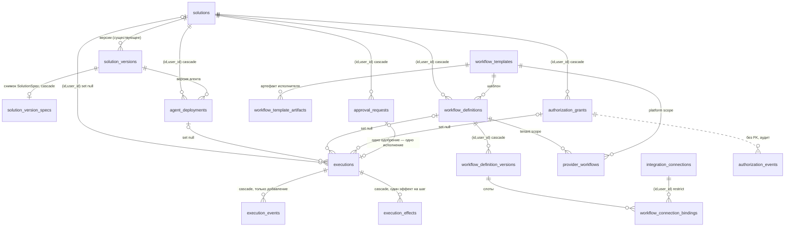

# Хранение платформы агентов: итоговый проект на одобрение

Составлено 08.11.2026, пятая редакция; 12.11.2026 — для первой вехи выделен **Slice A** (раздел 9) — после проверки отката по каталогу и двухфазных эффектов. Статус — **проект, ждёт одобрения**. Миграции не добавлены в `apps/mock-api/src/db/migration-list.ts` (оттуда они применяются автоматически при старте сервера) и не применялись к базе проекта. Код приложения не менялся.

| Файл                                                                       | Что это                                                                                                          |
| -------------------------------------------------------------------------- | ---------------------------------------------------------------------------------------------------------------- |
| [PERSISTENCE_MIGRATIONS_PROPOSAL.sql](PERSISTENCE_MIGRATIONS_PROPOSAL.sql) | Полный SQL миграций `0013`–`0017`                                                                                |
| [PERSISTENCE_MIGRATIONS_ROLLBACK.sql](PERSISTENCE_MIGRATIONS_ROLLBACK.sql) | Откат схемы к `0012`                                                                                             |
| [persistence-review/](persistence-review/)                                 | Проверка: `run-review.sh` поднимает одноразовый кластер Postgres 16 с ролями как в Supabase и прогоняет всё ниже |

## 0. Что изменилось после обзора

| Находка обзора                                                                                                                                                                       | Что сделано                                                                                                                                                                        |
| ------------------------------------------------------------------------------------------------------------------------------------------------------------------------------------ | ---------------------------------------------------------------------------------------------------------------------------------------------------------------------------------- |
| Триггер «только добавление» на `execution_events` блокировал каскадное обнуление ссылки на разрешение — удаление решения в Builder упало бы                                          | В событиях ссылки на разрешение и одобрение — текст без внешнего ключа; аудит сохраняет ссылку и после удаления разрешения                                                         |
| Журнал исполнений удалялся вместе с решением — терялись финансовые итоги                                                                                                             | Журнал остаётся: `solution_id`, `workflow_definition_id`, `grant_id`, `approval_request_id` обнуляются (`ON DELETE SET NULL (колонка)`); при создании ссылки обязательны (триггер) |
| Повторный вызов агента из процесса привёл бы к повторному вызову модели и второму списанию кредитов (`CreditService.charge` → `debit` не идемпотентен)                               | Новая таблица `execution_effects`: один эффект на шаг, резерв до действия, повтор находит готовый результат                                                                        |
| RLS без политик ошибочно можно было понять как изоляцию клиентов                                                                                                                     | Проверено по ролям (раздел 1): сервер Ketner RLS обходит; изоляция — в коде и составных ключах                                                                                     |
| На стенде 18 таблиц `0001`–`0011` были без RLS. **В production (проверено владельцем 11.11.2026) RLS включён на всех таблицах `public`**; лишние только права `anon`/`authenticated` | Отдельное исправление прав: [SECURITY_PRIVILEGE_AUDIT.md](SECURITY_PRIVILEGE_AUDIT.md); в эти миграции не входит                                                                   |

Пятая редакция (разрешение двух расхождений проверки):

| Изменение                                                                                                                                                                                                                                         | Зачем                                                                                                                                                                                                                                                                                    |
| ------------------------------------------------------------------------------------------------------------------------------------------------------------------------------------------------------------------------------------------------- | ---------------------------------------------------------------------------------------------------------------------------------------------------------------------------------------------------------------------------------------------------------------------------------------- |
| Снимок `SolutionSpec` — новая таблица `solution_version_specs` вместо колонки `solution_versions.solution_spec`                                                                                                                                   | `ADD COLUMN` + `DROP COLUMN` оставляет в `pg_attribute` запись удалённой колонки — настоящее изменение существующего объекта, которое `pg_dump` не показывает. Теперь существующие таблицы получают только ограничение `UNIQUE (id, user_id)` у `solutions`, которое удаляется без следа |
| Эффекты — двухфазная отправка: `reserved` → `dispatched` (фиксируется до запроса провайдеру) → `committed` / `failed` / `unknown`; поля `external`, `dispatched_at`, `lease_expires_at`, `idempotency_expires_at`, `failure_stage`, `resolved_by` | Без отдельной фиксации «отправлено» нельзя отличить сбой до отправки (повтор безопасен) от падения после отправки (исход неизвестен)                                                                                                                                                     |
| Повтор после `unknown` — только при поддержке ключа провайдером и пока провайдер его хранит; срок хранения ключа задаётся при первой отправке и не продлевается; иначе — сверка или решение человека (`resolved_by` обязателен)                   | Требование однократного внешнего действия там, где его можно гарантировать                                                                                                                                                                                                               |
| Проверка отката — нормализованный каталог PostgreSQL, данные всех таблиц, записи раннера и сырой `pg_dump`                                                                                                                                        | Предыдущая проверка сравнивала только отфильтрованный `pg_dump`                                                                                                                                                                                                                          |

Четвёртая редакция (финальная проверка):

| Изменение                                                                                                                                       | Зачем                                                                                                                                                                                                                                                             |
| ----------------------------------------------------------------------------------------------------------------------------------------------- | ----------------------------------------------------------------------------------------------------------------------------------------------------------------------------------------------------------------------------------------------------------------- |
| `execution_effects.authorized_by` — неизменяемый источник авторизации (`grant:<id>`, `approval:<id>`, `legacy_bot_enablement:<id>`, `risk_low`) | Аудит не теряет, чем было разрешено действие, после удаления разрешения или решения (`grant_id` обнуляется, `authorized_by` остаётся)                                                                                                                             |
| `execution_effects.provider_idempotency_key` (генерируется: `ketner:<исполнение>:<шаг>`) и `provider_supports_idempotency`                      | Один и тот же ключ у всех повторов шага; провайдер с поддержкой ключа не выполнит действие дважды                                                                                                                                                                 |
| `REVOKE ALL` у `anon` и `authenticated` на 15 новых таблицах (только если эти роли есть в базе)                                                 | RLS не действует на `TRUNCATE`; права по умолчанию Supabase дают его ролям API. Проверено: на новых таблицах роли API не имеют прав, на `pricing_versions` из `0012` `TRUNCATE` у `anon` прошёл                                                                   |
| Триггер `execution_effects_guard` — допустимые переходы статуса                                                                                 | Повтор только после явного сбоя (`failed → reserved`, попытка + 1); неизвестный исход повторяется автоматически только у провайдера с ключом идемпотентности; окончательная запись и источник авторизации не меняются; ссылку на разрешение можно только обнулить |

## 1. RLS по ролям

### 1.1. Проверка

Одноразовый кластер Postgres 16.15 с ролями как в Supabase:

- `anon`, `authenticated` — без BYPASSRLS;
- `service_role` — с BYPASSRLS;
- `authenticator` — роль входа API;
- права по умолчанию на таблицы схемы `public` выданы `anon`, `authenticated` и `service_role`.

Роли сервера Ketner, три варианта:

- `ketner_backend` — владелец таблиц без BYPASSRLS. Так работает сервер: миграции и `CREATE TABLE` выполняет он сам;
- `ketner_backend_bypass` — не владелец, с BYPASSRLS;
- `ketner_restricted` — не владелец, без BYPASSRLS.

Таблицы: `pricing_versions` (`0012`), `solutions` (`0004`), `executions` и `authorization_events` (новые). Скрипт — [persistence-review/rls-roles.sql](persistence-review/rls-roles.sql).

**Модель стенда с 11.11.2026 — как production** (R1–R3 владельца):

- событийный триггер `rls_auto_enable` (модель: [security-review/rls-auto-enable-model.sql](security-review/rls-auto-enable-model.sql)) включает RLS на **каждой** новой таблице `public`, поэтому RLS включён и на `solutions`, и на всех таблицах `0001`–`0011`;
- права по умолчанию Supabase выдают ролям API всё на таблицы и `EXECUTE` на функции.

Предыдущая редакция этого раздела описывала стенд без событийного триггера (`solutions` без RLS, `anon` читал 5 строк и вставлял) — для production это неверно.

Результат прогона 11.11.2026 (PostgreSQL 16.15; чтение — число видимых строк; вставка и `TRUNCATE` откатывались сразу; `executions` — только чтение и `TRUNCATE`):

| Роль                                                        | `pricing_versions` (`0012`, права по умолчанию)             | `solutions` (`0004`, права по умолчанию)                                                            | `authorization_events`, `executions` (новые: `REVOKE` у ролей API)                                          |
| ----------------------------------------------------------- | ----------------------------------------------------------- | --------------------------------------------------------------------------------------------------- | ----------------------------------------------------------------------------------------------------------- |
| `anon`, `authenticated`                                     | 0 строк; вставка — отказ RLS (42501); **`TRUNCATE` прошёл** | 0 строк; вставка — отказ RLS; `TRUNCATE` — отказ (каскад на `solution_version_specs`, где прав нет) | нет прав: чтение, вставка, `TRUNCATE` — 42501                                                               |
| `service_role` (BYPASSRLS)                                  | всё                                                         | всё (5 строк)                                                                                       | всё (4 и 3 строки)                                                                                          |
| `ketner_backend` (владелец, без BYPASSRLS) — модель сервера | всё                                                         | всё                                                                                                 | всё                                                                                                         |
| `ketner_backend_bypass` (не владелец, BYPASSRLS)            | всё                                                         | всё                                                                                                 | чтение — да; **вставка в `authorization_events` — 42501 «нет права на функцию `platform_contains_secret`»** |
| `ketner_restricted` (не владелец, без BYPASSRLS, с правами) | 0 строк, вставка — отказ RLS, `TRUNCATE` прошёл             | то же                                                                                               | то же                                                                                                       |

**Следствие отзыва `EXECUTE`:**

- Ограничения `CHECK (NOT platform_contains_secret(…))` вызывают функцию от имени того, кто пишет строку. После `REVOKE EXECUTE … FROM PUBLIC` писать в такие таблицы могут только владелец функций (сервер) и роли, которым `EXECUTE` выдан явно (здесь — `service_role` через права по умолчанию Supabase).
- В production сервер — `postgres`, владелец таблиц и функций: ограничения нет.
- Если когда-нибудь сервер будет работать ролью, которая не владеет функциями, ей нужен `GRANT EXECUTE` на функции предложения.

Атрибуты ролей (`pg_roles`):

| Роль                                          | `rolsuper` | `rolbypassrls` | Владелец таблиц | Почему видит данные                                                                      |
| --------------------------------------------- | ---------- | -------------- | --------------- | ---------------------------------------------------------------------------------------- |
| `anon`, `authenticated`                       | false      | false          | нет             | Не видит в таблицах с RLS; видит в таблицах без RLS при правах по умолчанию              |
| `authenticator`                               | false      | false          | нет             | Только переключается на роли выше                                                        |
| `service_role`                                | false      | **true**       | нет             | BYPASSRLS                                                                                |
| `ketner_backend` — модель роли сервера Ketner | false      | false          | **да**          | Владелец таблиц: RLS к нему не применяется (`relforcerowsecurity = false` у всех таблиц) |

Факты по таблицам (`pg_class`, `pg_policies`, `information_schema.role_table_grants`) после предложения:

| Таблицы                  | Владелец         | `relrowsecurity`                                               | `relforcerowsecurity` | Политик | Права `anon`/`authenticated`         | Права `service_role` |
| ------------------------ | ---------------- | -------------------------------------------------------------- | --------------------- | ------- | ------------------------------------ | -------------------- |
| 15 новых таблиц          | `ketner_backend` | true                                                           | false                 | 0       | **нет** (`REVOKE ALL` в предложении) | все                  |
| 4 таблицы `0012` (смета) | `ketner_backend` | true                                                           | false                 | 0       | все (права по умолчанию)             | все                  |
| 18 таблиц `0001`–`0011`  | `ketner_backend` | true (событийный триггер; в production — проверено 11.11.2026) | false                 | 0       | все (права по умолчанию)             | все                  |

**Production (проверено владельцем проекта 11.11.2026):**

- сервер подключается ролью `postgres`: `rolsuper = false`, `rolbypassrls = true`, `rolcanlogin = true`. У `service_role` тоже BYPASSRLS; у `anon` и `authenticated` — нет;
- **все** таблицы `public` принадлежат `postgres`, RLS включён на всех (`relrowsecurity = true`), `FORCE` выключен (`relforcerowsecurity = false`). Модель стенда «18 таблиц без RLS» для production неверна — в production RLS уже включён везде;
- у `anon` и `authenticated` остаются права по умолчанию на всех таблицах (в том числе `SELECT`, `INSERT`, `TRUNCATE`).

Роль сервера в production — одновременно владелец таблиц и BYPASSRLS, то есть RLS к ней не применяется по двум причинам. Выводы раздела 1.2 для сервера не меняются. Политик и представлений в схеме `public` нет; версия — PostgreSQL 17.6 (проверено владельцем 11.11.2026).

### 1.2. Вывод

- **`TRUNCATE` RLS не подчиняется** (так устроен PostgreSQL): `anon` очистил таблицу `pricing_versions` из `0012`, хотя RLS включён. Через Data API Supabase `TRUNCATE` не выполнить, но права на него у ролей API лишние. Поэтому предложение снимает все права у `anon` и `authenticated` на новых таблицах.
- **Обходят RLS:**
  - `service_role` (BYPASSRLS);
  - роль-владелец таблиц — то есть роль, которой работает сервер Ketner: таблицы создаёт он сам, а владельца RLS не касается без `FORCE ROW LEVEL SECURITY`;
  - любая роль с BYPASSRLS и суперпользователь.
- **Подчиняются RLS:** `anon`, `authenticated` и любая роль, которая не владелец таблиц и не имеет BYPASSRLS. Без политик чтение возвращает 0 строк, вставка отклоняется.
- **Изоляцию клиентов RLS не обеспечивает** и в этом проекте на неё не опирается. RLS без политик закрывает новые таблицы от API Supabase (PostgREST, ключ `anon`) — и только. Изоляция клиентов держится на проверках владельца в каждом запросе сервера и на составных внешних ключах `(id, user_id)` (раздел 6.3).

### 1.3. Что проверить на настоящем Supabase (только чтение)

Какой ролью ходит сервер, по коду не определить: это задаёт `DATABASE_URL` на Render. Владельцу проекта — выполнить в SQL-редакторе Supabase или `psql "$DATABASE_URL"`, ничего не меняя:

```sql
-- Кто подключается (выполнить именно через DATABASE_URL сервера).
SELECT current_user, r.rolsuper, r.rolbypassrls FROM pg_roles r WHERE r.rolname = current_user;
-- Владелец таблиц, RLS, доступ ролей API к существующим таблицам.
SELECT c.relname, pg_get_userbyid(c.relowner) AS owner, c.relrowsecurity AS rls, c.relforcerowsecurity AS force_rls,
       has_table_privilege('anon', c.oid, 'SELECT') AS anon_select,
       has_table_privilege('authenticated', c.oid, 'SELECT') AS authenticated_select
FROM pg_class c JOIN pg_namespace n ON n.oid = c.relnamespace
WHERE n.nspname = 'public' AND c.relkind = 'r' ORDER BY c.relname;
-- Версия: для ON DELETE SET NULL (колонка) нужна 15+.
SELECT version();
```

**Находка безопасности (вне этих миграций).** Ранее (по стенду) предполагалось, что 18 существующих таблиц без RLS читаются ролью `anon`. В production RLS включён на всех таблицах (проверено 11.11.2026), поэтому чтение строк через API Supabase без политик невозможно. Остаются лишние права `anon`/`authenticated` (в том числе `TRUNCATE`, на который RLS не действует) и права по умолчанию, которые выдадут их каждой новой таблице. Исправление — `REVOKE ALL` и `ALTER DEFAULT PRIVILEGES`, без изменения RLS: [SECURITY_PRIVILEGE_AUDIT.md](SECURITY_PRIVILEGE_AUDIT.md).

## 2. Учётные данные: где источник истины

| Вид                                                              | Где секрет (источник истины)                                            | Что хранит Ketner                                                                                                                                                        | Запрещено                                                       |
| ---------------------------------------------------------------- | ----------------------------------------------------------------------- | ------------------------------------------------------------------------------------------------------------------------------------------------------------------------ | --------------------------------------------------------------- |
| OAuth через n8n (токены передаёт Ketner после своей авторизации) | n8n: `oauthTokenData` в зашифрованных учётных данных; обновляет сам n8n | `integration_connections`: владелец, провайдер, вид авторизации, `engine = 'n8n'`, `engine_credential_id`, области, статус, кто и когда подключил и отозвал. Токенов нет | Копия токенов у Ketner (после обновления в n8n она устарела бы) |
| Ключ API или токен бота для действий в n8n                       | n8n                                                                     | То же                                                                                                                                                                    | Копия ключа у Ketner                                            |
| Сервисный аккаунт Ketner (например, Google)                      | Секрет Ketner в окружении Render; клиент даёт доступ своему ресурсу     | Подключение с `auth_kind = 'service_account'`, ресурсы клиента в метаданных                                                                                              | Ключ сервисного аккаунта в базе                                 |
| Ключ для действий, которые выполняет сам Ketner (без n8n)        | Ketner: `secret_enc` (AES-256-GCM, как `github_connections`)            | Подключение с `engine = 'ketner'`                                                                                                                                        | `secret_enc` при `engine = 'n8n'` (ограничение базы)            |
| GitHub для Ketner Code                                           | `github_connections` (существующий механизм)                            | Без изменений                                                                                                                                                            | —                                                               |

Журналы (`executions`, `execution_events`, `execution_effects`, `authorization_*`) не содержат секретов. Это держат две линии:

1. очиститель в коде (при реализации сервиса);
2. ограничение `platform_contains_secret` в базе — **сигнальная проверка, не граница безопасности**. С 12.11.2026 правила переписаны (раздел 9.3): прежний вариант отклонял безобидное (поле `password` в JSON-схеме, текст «The bearer certificate is valid») и пропускал `{"accessToken": "…"}` и `{"token": "sk-live-…"}`.

Повторное хранение учётных данных не нужно ни для одного сценария, поэтому не предусмотрено.

## 3. Жизненный цикл разрешений

### 3.1. Когда разрешение проверяется заново

| Момент                                                                          | Проверка                                                                                                                                                                                                                                   |
| ------------------------------------------------------------------------------- | ------------------------------------------------------------------------------------------------------------------------------------------------------------------------------------------------------------------------------------------ |
| Создание исполнения                                                             | Решение и развёртывание активны; разрешение или одобрение существует                                                                                                                                                                       |
| **Каждое внешнее действие** (шаг с риском MEDIUM и выше или с внешним эффектом) | Атомарное использование разрешения в одной транзакции с резервом шага (`execution_effects`)                                                                                                                                                |
| Повтор исполнения                                                               | Каждый шаг заново проходит ту же проверку; уже подтверждённые шаги не повторяются и разрешение повторно не тратят                                                                                                                          |
| Продолжение после ожидания (одобрение, задержка)                                | Как новый шаг                                                                                                                                                                                                                              |
| Шаги внутри n8n                                                                 | Шаблон процесса обязан перед каждым внешним действием вызвать Ketner (`authorize-step` с ключом шага) и продолжать только при ответе «разрешено». Это проверяется при одобрении шаблона. Ketner резервирует эффект и использует разрешение |

### 3.2. Отзыв во время исполнения

- Шаг, который уже использовал разрешение, завершается. Внешнее действие не обрывается на середине.
- Отзыв ждёт его завершения: блокировка строки разрешения, без промежуточного состояния.
- Следующий шаг получает отказ. Эффект отмечается `denied`, в журнал разрешений пишется событие `denied`, исполнение переходит в `cancelled` с причиной `authorization_revoked`.
- Сделанное до отзыва не откатывается; это видно в журнале.
- Отзыв разрешения, которым пользуются процессы в n8n, дополнительно останавливает идущие запуски (`POST /api/v1/executions/{id}/stop`). Проверка в начале каждого шага остаётся главной защитой.

Проверено на двух одновременных соединениях ([persistence-review/revocation-race.mjs](persistence-review/revocation-race.mjs)) — 8 из 8:

- шаг, начатый до отзыва, завершён, отзыв дождался его фиксации;
- следующий шаг — отказ, исполнение `cancelled` с причиной, разрешение использовано ровно 1 раз;
- в обратном порядке шаг ждал незафиксированный отзыв и после его фиксации получил отказ — окна нет.

### 3.3. Что можно и что нельзя отменить после отправки запроса провайдеру

| Момент отзыва                                               | Что происходит                                                                                                                                                                                     |
| ----------------------------------------------------------- | -------------------------------------------------------------------------------------------------------------------------------------------------------------------------------------------------- |
| До резерва шага                                             | Шаг не резервируется: отказ, исполнение `cancelled` (`authorization_revoked`)                                                                                                                      |
| Шаг зарезервирован, запрос провайдеру ещё не отправлен      | Отзыв ждёт фиксации транзакции шага; сервис перед отправкой ещё раз читает состояние разрешения (`revoked_at`) и при отзыве отмечает шаг `denied`, не отправляя запрос                             |
| Запрос провайдеру отправлен                                 | **Отменить нельзя.** Сообщение в Telegram, письмо, запись в таблицу уже ушли. Шаг получает итог по ответу (`committed`/`failed`) или `unknown`, если ответа нет. Отзыв действует на следующие шаги |
| Действие у провайдера обратимо (например, запись в таблицу) | Компенсирующее действие — отдельный шаг со своей авторизацией, не «отмена». Автоматически не выполняется                                                                                           |
| Запуск процесса в n8n идёт                                  | `POST /api/v1/executions/{id}/stop` останавливает следующие узлы; уже выполненные узлы не откатываются                                                                                             |

## 4. Идемпотентность и списание кредитов

| Источник повтора                                        | Защита                                                                                                                                                                                                      | Проверено                          |
| ------------------------------------------------------- | ----------------------------------------------------------------------------------------------------------------------------------------------------------------------------------------------------------- | ---------------------------------- |
| Повторный внешний вебхук (провайдер повторяет доставку) | `executions (user_id, idempotency_key)` уникально; ключ — id события провайдера (например, `telegram:update:<id>`); вставка `ON CONFLICT DO NOTHING` — второе исполнение не создаётся, модель не вызывается | Да                                 |
| Повтор исполнения после сбоя                            | `execution_effects (execution_id, step_key)` — первичный ключ; подтверждённый шаг не резервируется второй раз, внешнее действие не повторяется                                                              | Да                                 |
| Повторный HTTP-вызов агента из n8n (повтор узла)        | Тот же эффект шага: повторный вызов возвращает готовый результат (`result_ref`) без вызова модели — второго списания нет                                                                                    | Да                                 |
| Повторное использование разрешения при повторе          | Разрешение используется при резерве шага один раз                                                                                                                                                           | Да: `uses_count = 1` после повтора |
| Повтор у исполнителя                                    | `executions (provider, provider_execution_id)` уникально                                                                                                                                                    | Да                                 |
| Бесконечные повторы                                     | `retry_count ≤ max_retries ≤ 3` (ограничение базы)                                                                                                                                                          | Да                                 |
| Шаг «завис» (`reserved` без итога после сбоя процесса)  | Не повторяется автоматически: статус `unknown` и уведомление владельцу (at-most-once для внешних действий)                                                                                                  | По проекту; задача сервиса         |

### 4.1. Машина состояний внешнего действия

```
              ┌────────────── failed (before_dispatch | provider_rejected | reconciled_not_done) ◄──┐
              │  повтор, попытка + 1                                                             │
INSERT ─► reserved ──(фиксация ДО запроса)──► dispatched ──► committed                           │
   │          │                                    │     └─► failed (provider_rejected) ─────────┤
   │          ├─► denied (отзыв разрешения)        └─► unknown ──► committed | failed ───────────┘
   │          └─► failed (before_dispatch; в т. ч. истекла аренда)    │   (только с resolved_by: сверка или человек)
   │                                                                   └─► reserved (попытка + 1) — ТОЛЬКО если
   └─► denied                                                              провайдер поддерживает ключ и
                                                                           idempotency_expires_at > now()
Внутреннее действие Ketner (external = false): reserved → committed | failed | denied, без dispatched/unknown.
Зависший шаг (аренда истекла): reserved → failed(before_dispatch), dispatched → unknown.
```

Триггер `execution_effects_guard` отклоняет любой другой переход (проверено: `unknown → dispatched`, повтор без увеличения попытки, разрешение неясного исхода без `resolved_by`, продление срока хранения ключа, пропуск `dispatched` у внешнего действия, отправка внутреннего действия).

**Срок хранения ключа у провайдера.** При первой отправке сервис записывает `idempotency_expires_at` = время отправки + срок, который провайдер хранит ключ. Срок берётся из профиля провайдера в реестре интеграций; например, Stripe по своей документации хранит ключи не менее 24 часов. Повторные отправки срок не продлевают (триггер). После истечения повтор с тем же ключом небезопасен: провайдер мог забыть ключ. Поэтому повтор `unknown` запрещён и нужна сверка. Значения сроков для каждого провайдера — **не проверены**, задаются при подключении провайдера.

**Повтор после подтверждённого отказа у провайдеров, которые запоминают ответ по ключу.** Некоторые провайдеры в пределах срока возвращают на тот же ключ сохранённую ошибку. Тогда повтор шага с тем же ключом бесполезен: процесс создаёт новый шаг (новый `step_key`), а не повторяет старый.

**Списание кредитов не зависит от отправки.** Вызов модели — отдельный внутренний шаг со своим эффектом; повторы, сбои и неясные исходы шага отправки его не затрагивают (проверено: 1 списание после всех сценариев 1–6). **Не решено:** сегодня `CreditService.charge` не принимает ключ идемпотентности (списание не идемпотентно само по себе, держится на одном вызове на ответ). До запуска исполнений нужно изменение кода: списание по ключу `ketner:<исполнение>:<шаг>`. Это изменение приложения, оно вне этих миграций.

**Неоднозначный исход (ровно один раз гарантировать нельзя).** Запрос ушёл, а ответа нет: таймаут, обрыв соединения, сбой процесса. Ketner не знает, выполнено ли действие. Тогда:

- шаг получает статус `unknown`, автоматически он **не** повторяется (триггер базы);
- если провайдер поддерживает ключ идемпотентности (`provider_supports_idempotency`), повтор с тем же `provider_idempotency_key` разрешён: провайдер вернёт результат первого запроса и не выполнит действие второй раз;
- иначе — сверка с провайдером (если у него есть поиск по нашим данным) или решение владельца в интерфейсе: «выполнено» / «повторить». До решения — at-most-once: лучше не отправить, чем отправить дважды.

| Провайдер (по его документации; подтверждать при подключении) | Ключ идемпотентности            | Повтор после `unknown`                                                  |
| ------------------------------------------------------------- | ------------------------------- | ----------------------------------------------------------------------- |
| Stripe и другие API с заголовком `Idempotency-Key`            | Есть                            | Автоматически, с тем же ключом                                          |
| Telegram Bot API (`sendMessage`)                              | Нет                             | Только после сверки или решения владельца                               |
| Почта (SMTP)                                                  | Нет                             | Только после сверки или решения владельца                               |
| Google Sheets (добавление строк)                              | Нет                             | Только после сверки (поиск строки по id исполнения в служебной колонке) |
| Действия внутри Ketner (заявка, черновик, вызов модели)       | Есть: эффект шага в той же базе | Повтор возвращает готовый результат                                     |

**Списание кредитов не меняется.** Его делает AIGateway: `CreditService.charge` — один раз на ответ модели. Каждый вызов модели внутри исполнения идёт с `runId` = id исполнения (существующее поле `UsageRecord.runId`), поэтому сумма записей учёта по этому `runId` — фактический расход исполнения. В `executions.cost_usd`/`credits_usd` пишется итог, а шаги с моделью хранят `usage_run_id`. Своей логики списания у журнала нет.

## 5. Удаление и хранение

| Что удаляется                       | Что происходит                                                                                                                                                                                         | Что сохраняется                                                                                                                                      |
| ----------------------------------- | ------------------------------------------------------------------------------------------------------------------------------------------------------------------------------------------------------ | ---------------------------------------------------------------------------------------------------------------------------------------------------- |
| Решение (как сейчас в Builder)      | Удаляются версии, тест-кейсы, диалоги бота (как сейчас), развёртывания агента, процессы решения, разрешения и одобрения решения                                                                        | Строки журнала исполнений со стоимостью (`solution_id = NULL`), их события и эффекты; журнал разрешений; подключения клиента. Проверено              |
| Агент (= решение типа помощник/бот) | Как решение                                                                                                                                                                                            | Как решение                                                                                                                                          |
| Процесс                             | Сначала сервис удаляет процесс у исполнителя (n8n), затем строка определения; версии, привязки подключений и `provider_workflows` удаляются каскадом                                                   | Исполнения с номером версии и id запуска у исполнителя (`workflow_definition_id = NULL`). Проверено                                                  |
| Подключение (учётные данные)        | Не удаляется строкой, пока его использует процесс (внешний ключ). Отзыв: деактивировать зависимые процессы, удалить учётные данные в n8n, отметить `revoked` — без секрета и ссылки (ограничение базы) | Метаданные отозванного подключения (кто, когда, провайдер) — аудит безопасности. Проверено                                                           |
| Разрешение                          | Не удаляется вручную, только отзывается. Удаляется вместе с решением                                                                                                                                   | Журнал разрешений (`granted`, `used`, `revoked`…) — без внешних ключей, переживает удаление. Проверено                                               |
| Журнал исполнений                   | Очистка по сроку (задача воркера): события и эффекты — 90 дней; строки исполнений — 1 год                                                                                                              | Журнал разрешений остаётся. Финансовые записи — `credit_grants` и учёт расхода в `ketner_docs` — живут по своим правилам и журналом не затрагиваются |
| Аккаунт клиента                     | Маршрута удаления аккаунта сейчас нет. При появлении: удалить учётные данные у исполнителя, затем все строки клиента                                                                                   | Решение владельца: обезличивать журнал разрешений или хранить для аудита                                                                             |

### 5.1. Неизменяемые события: что сохраняется без внешних ключей

У `execution_events` нет внешних ключей на разрешения и одобрения. Это не теряет ни владельца, ни идентичность, ни контекст аудита:

| Что                  | Где хранится                                                                                                        | После удаления решения или разрешения                                                                                     |
| -------------------- | ------------------------------------------------------------------------------------------------------------------- | ------------------------------------------------------------------------------------------------------------------------- |
| Владелец             | `execution_events.user_id NOT NULL` + составной ключ на `executions (id, user_id)`                                  | Сохраняется: исполнение не удаляется (`solution_id` обнуляется)                                                           |
| Идентичность события | первичный ключ `(execution_id, seq)`                                                                                | Сохраняется                                                                                                               |
| Чем разрешено        | `execution_events.grant_id` / `approval_request_id` — текст; `execution_effects.authorized_by` — неизменяемый текст | Сохраняется (проверено: `grant_id = 'g_e'` в событии и `authorized_by = 'grant:g_e'` в эффекте после удаления разрешения) |
| История разрешения   | `authorization_events` (без внешних ключей, только добавление)                                                      | Сохраняется                                                                                                               |
| Изменение события    | запрещено триггером                                                                                                 | Проверено: `UPDATE` отклонён (P0001)                                                                                      |

Удалить события можно только вместе с исполнением — очисткой по сроку хранения.

## 6. Итоговый проект миграций

### 6.1. Миграции

| Миграция                               | Содержимое                                                                                                                                                                                   |
| -------------------------------------- | -------------------------------------------------------------------------------------------------------------------------------------------------------------------------------------------- |
| `0013_platform_ownership_keys`         | `solutions` — ограничение `UNIQUE (id, user_id)`; таблица `solution_version_specs` (снимок `SolutionSpec` версии; существующие версии без строки); функция `platform_contains_secret`        |
| `0014_platform_integrations_workflows` | `integration_connections`, `workflow_templates`, `workflow_template_artifacts`, `workflow_definitions`, `workflow_definition_versions`, `workflow_connection_bindings`, `provider_workflows` |
| `0015_platform_agent_deployments`      | `agent_deployments`                                                                                                                                                                          |
| `0016_platform_authorization`          | `authorization_grants`, `approval_requests`, `authorization_events`, функция и триггер «только добавление»                                                                                   |
| `0017_platform_executions`             | `executions` (+ триггер обязательных ссылок), `execution_events`, `execution_effects`                                                                                                        |

В каждой миграции — RLS без политик для её таблиц (в файле предложения они собраны в конце).

### 6.2. Схема связей



### 6.3. Правила владения и авторизации

1. **Владелец — `user_id`** в каждой новой таблице, кроме общего каталога шаблонов (`workflow_templates`, `workflow_template_artifacts`) и общих процессов у исполнителя (`provider_workflows.scope = 'platform'`, `user_id IS NULL`).
2. **Составные внешние ключи `(id, user_id)`:** решение, развёртывание, процесс, подключение, разрешение, одобрение, исполнение — ссылка на объект другого владельца отклоняется базой.
3. **Хранилища ищут по `(id, user_id)`;** «чужое» неотличимо от «нет такого». Единственный поиск без владельца — входящий вебхук по случайному `provider_workflows.webhook_path` (+ секрет).
4. **Разрешение:**
   - одно действие на запись, без масок;
   - `max_risk` только `low`/`medium`; HIGH и CRITICAL — только одобрение каждого раза, CRITICAL — только с `verified_process_id`;
   - использование — атомарное: неотозванное, непросроченное, в пределах лимита, своего владельца;
   - сервер сверяет текущий риск действия при каждом использовании.
5. **Одобрение:** привязано к отпечатку действия и сроку; используется одним исполнением (уникальный индекс).
6. **Включённый бот для клиентов:**
   - вычисляемое разрешение на `reply.send_in_session`, `channel = public_page`, ресурс — страница этого бота, получатель — собеседник открытого диалога;
   - лимиты — существующие (суточный потолок, 30 кредитов на ответ); действует, пока бот включён;
   - других действий не покрывает. Записывается в `authorization_grants` (`source = legacy_bot_enablement`) при следующем включении через новый сервис.
7. **Журналы:** `authorization_events` и `execution_events` — только добавление (триггер); секреты отклоняются базой.

### 6.4. Индексы и ограничения (главное)

| Таблица                   | Уникальность                                                                                              | Индексы для запросов                                                      | Проверки                                                                                                                                                                                   |
| ------------------------- | --------------------------------------------------------------------------------------------------------- | ------------------------------------------------------------------------- | ------------------------------------------------------------------------------------------------------------------------------------------------------------------------------------------ |
| `solutions`               | `(id, user_id)`                                                                                           | —                                                                         | —                                                                                                                                                                                          |
| `integration_connections` | `(id, user_id)`; `(engine, engine_credential_id)`                                                         | `(user_id, status)`                                                       | секрет только у `engine = 'ketner'`; отозванное — без секрета и ссылки                                                                                                                     |
| `workflow_definitions`    | `(id, user_id)`; `(solution_id, key)`                                                                     | `(user_id, updated_at)`                                                   | ссылка на шаблон только у `catalog_template`                                                                                                                                               |
| `provider_workflows`      | `(provider, provider_workflow_id)`; `(provider, webhook_path)`; один живой на определение                 | —                                                                         | область `tenant`/`platform` согласована с владельцем                                                                                                                                       |
| `agent_deployments`       | `(id, user_id)`; одно открытое на решение                                                                 | `(user_id, activated_at)`                                                 | `ended` ⇔ `ended_at`                                                                                                                                                                       |
| `authorization_grants`    | `(id, user_id)`                                                                                           | `(user_id, action, solution_id)` для неотозванных                         | риск, маска, лимит, срок, отзыв, секреты                                                                                                                                                   |
| `approval_requests`       | `(id, user_id)`                                                                                           | ожидающие по владельцу                                                    | решение ⇔ кто и когда; CRITICAL ⇔ процесс                                                                                                                                                  |
| `executions`              | `(id, user_id)`; `(user_id, idempotency_key)`; `(provider, provider_execution_id)`; `approval_request_id` | `(user_id, created_at)`, `(solution_id, created_at)`, активные по статусу | повторы ≤ 3, ссылки по виду, время, секреты; при вставке — решение и процесс обязательны                                                                                                   |
| `execution_effects`       | `(execution_id, step_key)`                                                                                | `(user_id, reserved_at)`, открытые аренды, неясные исходы                 | открыт ⇔ нет `finished_at` ⇔ есть аренда; внутреннее действие без `dispatched`/`unknown`; `failed` ⇔ `failure_stage`; срок ключа при отправке; секреты; триггер переходов и неизменяемости |

### 6.5. Стратегия отката

1. **Основная — откат приложения.** Миграции только добавляют: старый код новых таблиц не знает, а ограничение `UNIQUE (id, user_id)` ему не мешает. Откат кода без отката схемы безопасен.
2. **Откат схемы** (только если таблицы ещё не используются) — [PERSISTENCE_MIGRATIONS_ROLLBACK.sql](PERSISTENCE_MIGRATIONS_ROLLBACK.sql). Он удаляет новое в обратном порядке и записи в `schema_migrations`. Перед ним — резервная копия. Проверено сравнением полного состояния (раздел 7.2): каталог, данные и записи раннера после отката совпадают с исходными; предложение накатывается повторно.
3. Изменения после выкладки — только новыми миграциями (раннер не допускает правки применённых).

### 6.6. Влияние на существующие данные

- **Существующие строки не меняются.** Проверено отпечатками до и после: `solutions` (3 строки), `solution_versions` (4 строки, те же 4 колонки — новых колонок у существующих таблиц нет), диалоги, сообщения и заявки бота.
- **Builder продолжает вставлять решения** без новых колонок (проверено).
- Добавление `UNIQUE (id, user_id)` строит индекс по `solutions`: таблица небольшая, блокировка — на время построения.
- Новые таблицы пустые; существующий код их не читает.
- Удаление решения в Builder проходит (проверено) и дополнительно сохраняет строки журнала исполнений.

## 7. Результаты проверки

Прогон 08.11.2026 с нуля: `bash docs/persistence-review/run-review.sh` — свежий кластер **PostgreSQL 16.15**, базы создаются заново, база проекта не затрагивается. Существующие миграции 0001–0012 накатывает **настоящий раннер приложения** (`runMigrations`: транзакция, advisory-lock, записи в `schema_migrations`); предложение — одной транзакцией вместе с записями раннера `0013`–`0017`.

**PostgreSQL 17.6 — прогон владельца проекта 11.11.2026** (тот же `run-review.sh`): изоляция 59/59, отзыв 8/8, идемпотентность 4/4, повторы 14/14; откат — каталог и данные идентичны; набор тестов сервера — 810 прошло, 0 упало, 1 пропущен. **Не проверено на 17:** сравнение `pg_dump` (не было `pg_dump` версии 17). Отзыв `EXECUTE` у функций предложения добавлен после этого прогона — на 17 не проверен, на 16.15 — раздел 7.1.

### 7.1. Сводка

Прогон 11.11.2026 на PostgreSQL 16.15 с моделью production (событийный триггер `rls_auto_enable`, права по умолчанию Supabase на таблицы и функции): изоляция 59/59, отзыв 8/8, функции 17/17, дубликаты 4/4, повторы 14/14, откат — каталог и данные идентичны, тесты сервера 810/0/1.

| #   | Часть                                                                                                                                                                    | Роль                                                                                                    | Результат                                                                                                                                                          |
| --- | ------------------------------------------------------------------------------------------------------------------------------------------------------------------------ | ------------------------------------------------------------------------------------------------------- | ------------------------------------------------------------------------------------------------------------------------------------------------------------------ |
| 1   | Раннер: 0001–0012; данные «как в production»; предложение                                                                                                                | `ketner_backend` (владелец таблиц)                                                                      | Раннер применил 12 миграций; предложение — без ошибок                                                                                                              |
| 2   | [isolation-check.sql](persistence-review/isolation-check.sql): существующие данные, изоляция, разрешения и секреты, идемпотентность, удаление и хранение, неизменяемость | `ketner_backend`                                                                                        | **59 из 59**; каждый отказ сверен с ожидаемым кодом ошибки                                                                                                         |
| 3   | [revocation-race.mjs](persistence-review/revocation-race.mjs): отзыв во время исполнения, два соединения                                                                 | `ketner_backend`                                                                                        | **8 из 8**                                                                                                                                                         |
| 4   | [rls-roles.sql](persistence-review/rls-roles.sql)                                                                                                                        | `anon`, `authenticated`, `service_role`, `ketner_backend`, `ketner_backend_bypass`, `ketner_restricted` | Матрица — раздел 1.1                                                                                                                                               |
| 4b  | [function-privileges.sql](persistence-review/function-privileges.sql): кто может вызвать функции предложения                                                             | суперпользователь проверяет `anon`, `authenticated`, `ketner_backend`, `PUBLIC`                         | 17/17 (прогон 11.11.2026, 16.15): вызвать может только владелец; `anon` при вызове получает 42501                                                                  |
| 5a  | [idempotency-race.mjs](persistence-review/idempotency-race.mjs): одновременные дубликаты и списание                                                                      | `ketner_backend`                                                                                        | **4 из 4**: 20 одинаковых вебхуков → 1 исполнение и 1 списание; 20 одновременных запросов шага → 1 вызов модели и 1 списание; повтор после фиксации → без списания |
| 5b  | [effect-retry.mjs](persistence-review/effect-retry.mjs): безопасные повторы (явные транзакции, `SELECT … FOR UPDATE`, проверки отдельными запросами после фиксации)      | `ketner_backend`                                                                                        | **14 из 14**, раздел 7.3                                                                                                                                           |
| 6   | Полный откат с сравнением состояния                                                                                                                                      | `ketner_backend` (накат/откат), `postgres` (снимок каталога, `pg_dump`)                                 | Раздел 7.2                                                                                                                                                         |
| 7   | Тесты сервера на настоящем Postgres                                                                                                                                      | `ketner_backend`                                                                                        | **810: 809 прошли, 0 упали, 1 пропущен** (нужна PGlite)                                                                                                            |

### 7.2. Откат: состояние до предложения и после отката

| Что сравнивалось                                                                                                                                                                                                                                                                                                                                                                                                              | До         | С предложением | После отката | Итог                                                               |
| ----------------------------------------------------------------------------------------------------------------------------------------------------------------------------------------------------------------------------------------------------------------------------------------------------------------------------------------------------------------------------------------------------------------------------- | ---------- | -------------- | ------------ | ------------------------------------------------------------------ |
| Нормализованный каталог ([catalog-snapshot.sql](persistence-review/catalog-snapshot.sql)): схемы, расширения, таблицы и их флаги (владелец, RLS, FORCE RLS, `relhastriggers`, `relhasindex`, права), колонки **включая удалённые**, ограничения, индексы, функции (с md5 текста), триггеры, внутренние триггеры внешних ключей (число), последовательности, политики, права по умолчанию, типы, представления, записи раннера | 471 объект | 929            | 471          | **Совпадает полностью**                                            |
| Данные ([state-snapshot.sql](persistence-review/state-snapshot.sql)): число строк и md5 всех строк каждой из 23 таблиц, включая `schema_migrations` (id, контрольные суммы, время применения)                                                                                                                                                                                                                                 | —          | —              | —            | **Совпадает полностью**                                            |
| Сырой `pg_dump --schema-only`                                                                                                                                                                                                                                                                                                                                                                                                 | —          | —              | —            | Отличаются **2 строки**: `\restrict <ключ>` и `\unrestrict <ключ>` |
| `pg_dump` без этих двух строк                                                                                                                                                                                                                                                                                                                                                                                                 | —          | —              | —            | **Совпадает**                                                      |

**Исключено из сравнения и почему это безопасно:**

| Исключение                                                         | Почему безопасно                                                                                                                                                                                                                                             |
| ------------------------------------------------------------------ | ------------------------------------------------------------------------------------------------------------------------------------------------------------------------------------------------------------------------------------------------------------ |
| Строки `\restrict` / `\unrestrict` в выводе `pg_dump`              | Случайный ключ, который `pg_dump` 16.15 генерирует при **каждом** запуске (защита psql от мета-команд при восстановлении); в базе он не хранится. Контрольный опыт: два дампа одной и той же неизменённой базы подряд различаются ровно этими двумя строками |
| OID объектов и `relfilenode`                                       | Внутренние номера, которые меняются при любом пересоздании; объекты сравниваются по именам и определениям                                                                                                                                                    |
| Статистика планировщика (`reltuples`, `relpages`, `relallvisible`) | Оценки для планировщика, обновляются `ANALYZE`/`VACUUM`; не схема и не данные                                                                                                                                                                                |

**Ранее найденное и исправленное:** колонка `solution_spec` у `solution_versions` после отката оставила бы в `pg_attribute` запись удалённой колонки (`attisdropped`). `pg_dump` её не показывает, а снимок каталога показал бы. Колонка заменена таблицей `solution_version_specs`, поэтому теперь записи нет: каталог совпадает полностью.

### 7.3. Безопасные повторы (effect-retry.mjs)

| Сценарий                                                          | Результат                                                                                                                                      | Действий у провайдера |
| ----------------------------------------------------------------- | ---------------------------------------------------------------------------------------------------------------------------------------------- | --------------------- |
| 1. Сбой до отправки (воркер упал после резерва)                   | Восстановление: `failed(before_dispatch)`; повтор без ключа провайдера — безопасен                                                             | 1                     |
| 2. Подтверждённый отказ провайдера                                | `failed(provider_rejected)`; повтор (попытка 2)                                                                                                | 1                     |
| 3a. Успех у провайдера, затем падение Ketner; провайдер без ключа | Восстановление: `unknown`; автоматический повтор отклонён базой; сверка нашла действие → `committed` (`resolved_by = reconciliation:telegram`) | 1                     |
| 3b. То же; провайдер с ключом, ключ хранится                      | Повтор с тем же ключом; провайдер вернул итог первого запроса                                                                                  | 1                     |
| 4. Таймаут, исход неизвестен (провайдер на деле не выполнил)      | Повтор отклонён; разрешение без `resolved_by` отклонено (23514); владелец подтвердил «не выполнено» → повтор                                   | 1                     |
| 5. Повтор после `unknown`, ключ хранится                          | Разрешён, провайдер вернул итог первого запроса                                                                                                | 1                     |
| 5. Повтор после `unknown`, срок хранения ключа истёк              | Отклонён, нужна сверка; продление срока отклонено (23514)                                                                                      | 1                     |
| 6. 10 одновременных повторов упавшего шага                        | Ровно 1 повтор (9 — «уже выполняется»), попытка 2                                                                                              | —                     |
| 6. 10 одновременных повторов после `unknown` (провайдер с ключом) | Ровно 1 повтор                                                                                                                                 | —                     |
| Переход `unknown → dispatched` в обход повтора                    | Отклонён (23514)                                                                                                                               | —                     |
| 7. Списание                                                       | 1 списание за шаг модели после всех сценариев; повторные вызовы с тем же ключом списания не добавили                                           | —                     |

## 8. Решения, которые нужны от владельца

**Не решено (помечено явно):**

- **Идемпотентность списания в коде.** `CreditService.charge` не принимает ключ; нужно изменение приложения до запуска исполнений (раздел 4.1).
- **Сроки хранения ключей идемпотентности у конкретных провайдеров** не проверены; задаются в профиле провайдера при подключении.
- ~~Роль настоящего сервера на Supabase~~ — проверена 11.11.2026: `postgres`, владелец всех таблиц, BYPASSRLS, не суперпользователь (раздел 1.1). Версия — PostgreSQL 17.6 (проверено): `ON DELETE SET NULL (колонка)` (нужна 15+) поддерживается. Стенд проверки — 16.15; прогон на 17 — SEC.2 в TRANSFORMATION_TASKS.md.

1. **Одобрить миграции `0013`–`0017`** (раздел 6). Перед переносом в `migration-list.ts` — выполнить запросы раздела 1.3 на Supabase: роль сервера, версия Postgres (нужна 15+).
2. **Права ролей API на существующих таблицах** (разделы 1.1, 1.3): в production RLS включён везде, но у `anon`/`authenticated` есть права по умолчанию, включая `TRUNCATE`. Отдельное исправление — [SECURITY_PRIVILEGE_AUDIT.md](SECURITY_PRIVILEGE_AUDIT.md): `REVOKE ALL` + `ALTER DEFAULT PRIVILEGES`, только после проверенной резервной копии (в проекте нет бэкапов).
3. **Сроки хранения:** события и эффекты — 90 дней, строки исполнений — 1 год.
4. **Удаление аккаунта** (когда появится): обезличивать журнал разрешений или хранить для аудита.
5. **Разрешение существующих ботов:** вычислять и записывать при следующем включении (предложение) или перенести задним числом отдельной миграцией данных.

## 9. Slice A — первая веха (12.11.2026)

Пятнадцать таблиц до первого исполнения — слишком много, а вопрос лицензии n8n открыт. Поэтому предложение разделено.

| Файл                                                                       | Что это                                                                                                            |
| -------------------------------------------------------------------------- | ------------------------------------------------------------------------------------------------------------------ |
| [PERSISTENCE_SLICE_A.sql](PERSISTENCE_SLICE_A.sql)                         | Slice A: миграции `0013_platform_agent_specs`, `0014_platform_agent_deployments`, `0015_platform_agent_executions` |
| [PERSISTENCE_SLICE_A_ROLLBACK.sql](PERSISTENCE_SLICE_A_ROLLBACK.sql)       | Откат Slice A к состоянию после `0012`                                                                             |
| [PERSISTENCE_SLICE_B_DEFERRED.md](PERSISTENCE_SLICE_B_DEFERRED.md)         | Отложенное: процессы и подключения (Slice B), разрешения и одобрения                                               |
| [persistence-review/slice-a/](persistence-review/slice-a/)                 | Стенд Slice A; последний прогон — [last-run.txt](persistence-review/slice-a/last-run.txt)                          |
| [PERSISTENCE_MIGRATIONS_PROPOSAL.sql](PERSISTENCE_MIGRATIONS_PROPOSAL.sql) | Полный вариант (15 таблиц): источник для следующих срезов, к первой вехе не применяется                            |

### 9.1. Таблицы Slice A и зачем каждая сценарию бота

Сценарий: посетитель пишет боту → цикл агента (`docs/AGENT_LOOP_CONVERGENCE.md`): шаг модели с вызовом `knowledge.search`, поиск, шаг модели с ответом, ответ в сессии.

| Таблица                  | Зачем в сценарии бота                                                                                                                                                                                                                           |
| ------------------------ | ----------------------------------------------------------------------------------------------------------------------------------------------------------------------------------------------------------------------------------------------- |
| `solution_version_specs` | Снимок `AgentSpec` той версии, которая отвечает: лимиты шагов и вызовов, разрешённые действия, потолок кредитов на ответ. Без строки спецификация выводится из настроек версии (как сейчас)                                                     |
| `agent_deployments`      | Какая версия включена и на каком рантайме (`agent_gateway` — собственный цикл поверх `AIGateway`); история включений и пауз (в том числе по лимиту)                                                                                             |
| `executions`             | Одна строка на ответ бота: итог, причина остановки (`stop_reason`: `answer`, `escalated`, `max_steps`, `budget`, …), стоимость и списание, связь с учётом шлюза (`usage_run_id`), ключ идемпотентности события канала (повтор вебхука Telegram) |
| `execution_events`       | Журнал шагов: шаги модели, проверки прав, повторы, ошибки, расход. Только добавление                                                                                                                                                            |
| `execution_effects`      | Не больше одного действия на шаг: повтор после сбоя находит готовый шаг модели и не вызывает модель второй раз (второго списания нет); ответ клиенту не отправляется дважды                                                                     |

**Не входят в Slice A:**

- **`authorization_grants`, `approval_requests`, `authorization_events`** — сценарию бота не нужны. Все действия бота не требуют одобрения (`platform/risk.ts` и `legacyApprovalPolicy('customer_bot')`):
  - `knowledge.search`, `lead.create`, `owner.notify` — риск LOW;
  - `reply.send_in_session` — MEDIUM наружу, но покрыт заранее выданным разрешением, которое даёт включение бота владельцем.

  Источник авторизации в эффекте — `risk_low` или `legacy_bot_enablement:<решение>`. Таблицы разрешений добавит отдельный срез вместе с первым действием, которому нужно одобрение (например, `message.send` агентом по каналу). Тогда же расширится проверка `authorized_by` и вернутся колонки `grant_id` и `approval_request_id`.

- **Процессы и подключения n8n** (Slice B, 7 таблиц) — после ответа n8n о лицензии и первого настоящего процесса.

**Отличия от полного варианта:**

- `executions.kind` — только `agent`;
- нет колонок процессов, исполнителя n8n, разрешений и одобрений;
- статус `waiting_approval` убран;
- добавлена колонка `stop_reason` и проверка, что причина остановки записывается только вместе со временем окончания.

Рантайм в `agent_deployments` и `executions` — **только `agent_gateway`**: `mastra` в ограничения не входит (решение 12.11.2026).

### 9.2. Проверка на стенде (PostgreSQL 16.15, 12.11.2026)

`bash docs/persistence-review/slice-a/run-review-slice-a.sh`. Модель production:

- роль сервера — владелец таблиц;
- права по умолчанию Supabase на таблицы и функции;
- событийный триггер `rls_auto_enable`.

| Часть                                                                                                                                                                                          | Результат                                                                                                                            |
| ---------------------------------------------------------------------------------------------------------------------------------------------------------------------------------------------- | ------------------------------------------------------------------------------------------------------------------------------------ |
| 1. Раннер 0001–0012, данные «как в production», Slice A одной транзакцией                                                                                                                      | Применился; новых таблиц ровно 5                                                                                                     |
| 2. `isolation-check-a.sql`: существующие данные, изоляция клиентов, рантайм, сигнальная проверка секретов, сценарий бота, идемпотентность, удаление, неизменяемость, форма JSON (с 14.11.2026) | **65/65** (было 38/38; см. 9.4)                                                                                                      |
| 3. Правила секретов: код и база на общем наборе примеров (`platform/secret-corpus.ts`); очищенный кодом документ база не отклоняет                                                             | **27/27**                                                                                                                            |
| 4. RLS по ролям                                                                                                                                                                                | Роли API не имеют прав на новые таблицы; сервер-владелец и `service_role` — всё                                                      |
| 4b. Права на функции                                                                                                                                                                           | **17/17**: вызвать может только владелец                                                                                             |
| 5a. Одновременные дубликаты                                                                                                                                                                    | **4/4**                                                                                                                              |
| 5b. Безопасные повторы двухфазных эффектов                                                                                                                                                     | **14/14**                                                                                                                            |
| 6. Откат на отдельной базе                                                                                                                                                                     | Каталог, данные (23 таблицы) и `pg_dump --schema-only` **идентичны** состоянию до Slice A; Slice A повторно применяется после отката |
| 7. Тесты сервера на Postgres                                                                                                                                                                   | 849: **848 прошло, 0 упало, 1 пропущен**                                                                                             |

**PostgreSQL 17.6 — независимый прогон владельца проекта 13.11.2026** (тот же скрипт на 16.15 и на 17.6): проверки Slice A 38/38, совпадение правил секретов 27/27, права на функции 17/17, откат — идентично, тесты сервера 848/0/1. Slice A проверен на обеих версиях.

### 9.3. `platform_contains_secret`: исправление

**Это не граница безопасности.** Защита данных — в том, что журналы получают только метаданные: размеры, имена полей, отпечатки, короткие безопасные выдержки. Правила ловят типичные утечки и могут пропустить секрет необычного вида.

**Правила** (одинаковые в коде `apps/mock-api/src/platform/secrets.ts` и в базе):

1. Поле с секретным именем со **строковым** значением от 4 символов. Имя сравнивается без учёта регистра, `_`, `-` и проверяется окончание: `…token`, `…secret`, `password`, `passwd`, `apiKey`, `privateKey`, `cookie`, `…TokenData`.
   - Имя поля в JSON-схеме не срабатывает: значение там — объект.
   - Пустая строка не срабатывает.
2. Поле `authorization` со значением вида `Bearer|Basic|Token|Digest <8+ символов>`. Ссылка вроде `legacy_bot_enablement:…` не срабатывает.
3. Известные форматы токенов в любой строке, включая текст:
   - `sk-…`, Stripe, GitHub, Slack, AWS;
   - JWT, приватный ключ PEM, токен бота Telegram;
   - `Bearer` с токеном от 20 символов, в котором есть цифра.
4. Отметка об очистке `[redacted]` / `[redacted:<причина>]` секретом не считается.

**Где проверка стоит:**

| Таблица                                                                                                                  | Проверка   | Почему                                                                                                                                                |
| ------------------------------------------------------------------------------------------------------------------------ | ---------- | ----------------------------------------------------------------------------------------------------------------------------------------------------- |
| `executions` (`context`, `input_meta`, `output_meta`, `error`), `execution_events.data`, `execution_effects.result_meta` | Сигнальная | Журнал: код пишет только очищенные метаданные                                                                                                         |
| `solution_version_specs.spec`                                                                                            | **Снята**  | Спецификация — свободный текст и имена полей (инструкции, знания, схемы входа и выхода); проверка давала бы ложные отказы. Спецификацию проверяет Zod |

**Запись журнала не может сорваться из-за проверки** (`writeJournalSafely`):

1. Метаданные очищаются в коде (`sanitizeForJournal`: найденное значение заменяется на `[redacted:<причина>]`).
2. Если проверка базы всё же сработала (правила кода и базы разошлись), строка пишется ещё раз с метаданными-заглушкой `{"redacted":"tripwire"}`, а расхождение уходит в журнал сервера как ошибка.
3. Любая другая ошибка базы пробрасывается.

Действие к этому моменту уже выполнено, и строка журнала о нём не теряется.

**Проверено:**

- тесты кода `platform/secrets.test.ts` — 31 (27 примеров набора, очистка, запись с заглушкой, проброс других ошибок);
- на Postgres — совпадение кода и базы на всех 27 примерах (раздел 9.2, часть 3);
- отказы и пропуски в таблицах — часть 2.

| Пример                            | Прежняя проверка | Сейчас      |
| --------------------------------- | ---------------- | ----------- |
| JSON-схема с полем `password`     | ложный отказ     | принимается |
| «The bearer certificate is valid» | ложный отказ     | принимается |
| `{"accessToken": "…"}`            | пропуск          | отклоняется |
| `{"token": "sk-live-…"}`          | пропуск          | отклоняется |

### 9.4. Форма JSON: только объекты (14.11.2026)

Причина: журнал в ветке передавал JSON как `$n::jsonb`, и драйвер postgres.js кодировал строку
ещё раз. В столбцах оказывались JSON-строки вместо объектов, а проверка
`spec ->> 'specVersion' = '1'` такую строку пропускала: выражение давало NULL, а CHECK с NULL не
отказывает. Код исправлен (`$n::text::jsonb`), схема теперь отклоняет такие записи сама:

| Таблица                  | Ограничение                                                                                                                                    |
| ------------------------ | ---------------------------------------------------------------------------------------------------------------------------------------------- |
| `solution_version_specs` | `solution_version_specs_spec_object`: `jsonb_typeof(spec) = 'object' AND (spec ->> 'specVersion') IS NOT DISTINCT FROM '1'` — без версии отказ |
| `executions`             | `executions_context_object`, `executions_input_meta_object`, `executions_output_meta_object`; `executions_error_object` — NULL или объект      |
| `execution_events`       | `execution_events_data_object`                                                                                                                 |
| `execution_effects`      | `execution_effects_result_meta_object`                                                                                                         |

На стенде (раздел 6 `isolation-check-a.sql`) для каждого столбца проверяется, что JSON-строка и
JSON-массив отклоняются именно этим ограничением (по имени, а не по коду 23514), а объект принимается.

**Исправлено попутно в стенде.** `expect_ok` писал строку PASS внутри блока, который сам же
откатывал. Ложный отказ стенд показывал (FAIL), но принятые операторы в счёт не попадали: прежние
38/38 не включали 4 проверки «принимается». Теперь их строка пишется после отката.

Прогоны 14.11.2026:

- **PostgreSQL 16.15:** 65/65, секреты 27/27, функции 17/17, гонки 4/4 и 14/14, откат идентичен
  (каталог, данные, `pg_dump`), тесты сервера 896/0/1;
- **PostgreSQL 17.6** (сервер из пакета embedded-postgres, клиент `psql` 16): 65/65, 27/27, 17/17,
  4/4, 14/14, откат идентичен по каталогу и данным, тесты 896/0/1. Сравнение `pg_dump` на 17 здесь не
  делалось: в пакете нет `pg_dump` 17.
